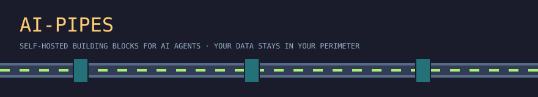
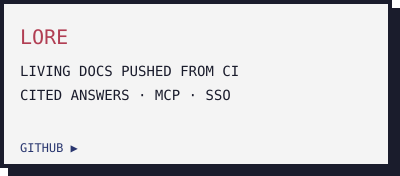
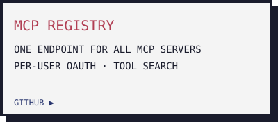
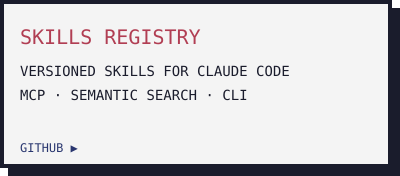
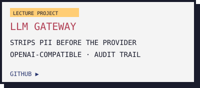

  

Self-hosted building blocks for teams that run AI agents inside their own perimeter: no SaaS in the middle, no data leaving your network. MIT-licensed, Docker Compose and Postgres.

  
  
  
  

Maintained by [Aleksandr Melnik](https://github.com/Isqanderm) · [tech-pioneer.info](https://tech-pioneer.info)
